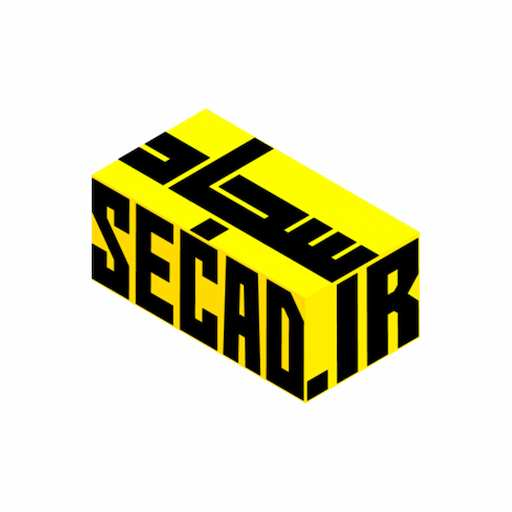

<div align="center">
  
  
  # سامانه آموزشی تدریس | Tadris SECAD.ir

  **پلتفرم اشتراک‌گذاری جزوات درسی و کدهای آموزشی**

  [](https://php.net)
  [](https://mysql.com)
  [](LICENSE)
  [-lightgrey.svg)]()

  [سامانه تدریس](https://tadris.secad.ir)
</div>

---

## 📝 درباره پروژه

**تدریس SECAD.ir** یک وب‌سایت سبک، سریع و کاملاً بهینه‌شده برای انتشار جزوات درسی و نمونه کدهای برنامه‌نویسی است. این پروژه با هدف ارائه یک تجربه کاربری (UX) عالی برای دانش‌آموزان و دانشجویان طراحی شده و بدون استفاده از هیچ فریم‌ورک سنگینی (مانند Laravel) و صرفاً با **PHP خالص** و **MySQL** توسعه یافته است.

این پروژه متعلق به **مهندس سجاد اسماعیلی** (برنامه‌نویس و توسعه‌دهنده وب اپلیکیشن، هنرآموز رسمی آموزش و پرورش) می‌باشد.

## ✨ امکانات کلیدی

- 📄 **پشتیبانی کامل از Markdown:** جزوات به صورت فایل‌های `.md` نوشته می‌شوند و به صورت خودکار به HTML زیبا تبدیل می‌شوند.
- 🌗 **حالت تاریک و روشن (Dark Mode):** تغییر پوسته با یک کلیک، همراه با ذخیره‌سازی در `localStorage` برای حفظ انتخاب کاربر.
- 📱 **طراحی کاملاً ریسپانسیو (Mobile-First):** نوار کناری در موبایل به صورت یک منوی کشویی (Drawer) در می‌آید.
- 📂 **سایدبار درختی (Accordion):** فهرست دروس به صورت پوشه‌های بازشونده نمایش داده می‌شود و همیشه در صفحه (Sticky) می‌ماند.
- 📋 **دکمه کپی کد:** برای بلوک‌های کد، دکمه‌ای جهت کپی سریع کدها در نظر گرفته شده است.
- 🎨 **صفحه اصلی مدرن:** شامل انیمیشن پس‌زمینه سبک، افکت شیشه‌ای (Glassmorphism) و لینک‌های سریع.
- 🔒 **معماری امن:** جدا کردن کامل فایل‌های منطق (`app`) و محتوا (`courses`) از پوشه عمومی (`public`) و استفاده از `PDO` برای اتصال به دیتابیس.

## 🛠 تکنولوژی‌های استفاده شده

- **Backend:** PHP 7.4+ (Vanilla - بدون Composer)
- **Database:** MySQL
- **Frontend:** HTML5, CSS3 (CSS Variables, Flexbox, Grid), Vanilla JavaScript
- **Markdown Parser:** [Parsedown](https://parsedown.org/)
- **Font:** [Vazirmatn](https://github.com/rastikerdar/vazirmatn)

## 📂 ساختار پوشه‌ها

```text
tadris-secad-ir/
│
├── app/                  # کدهای منطق برنامه (توابع، روتر، کتابخانه Parsedown)
├── config/               # تنظیمات (config.php در گیت نیست)
│   └── config.php.example
├── courses/              # منبع محتوا (پوشه هر دوره و فایل‌های .md)
├── public/               # ریشه وب‌سایت (Document Root)
│   ├── assets/           # فایل‌های CSS، JS و تصاویر
│   ├── index.php         # صفحه اصلی
│   ├── courses.php       # صفحه لیست دوره‌ها
│   ├── course.php        # صفحه نمایش درس و سایدبار
│   └── .htaccess         # تنظیمات سرور
│
├── .gitignore            # فایل‌های نادیده گرفته شده در گیت
├── .cpanel.yml           # تنظیمات استقرار در هاست cPanel
└── schema.sql            # ساختار پایگاه داده
```

## 🚀 راه‌اندازی در محیط لوکال (Local)

برای اجرای این پروژه روی سیستم خود (ویندوز با WSL، مک یا لینوکس):

**۱. کلون کردن مخزن:**
```bash
git clone https://github.com/secad135/tadris-secad-ir.git
cd tadris-secad-ir
```

**۲. ساخت فایل تنظیمات:**
فایل `config/config.php.example` را کپی کرده و نام آن را به `config/config.php` تغییر دهید. سپس اطلاعات دیتابیس لوکال خود را در آن وارد کنید (در WSL معمولاً یوزر `root` و پسورد خالی است).

**۳. اجرای سرور توکار PHP:**
```bash
php -S localhost:8000 -t public
```
حالا می‌توانید سایت را در مرورگر خود از طریق `http://localhost:8000` مشاهده کنید.

## 🌐 استقرار در هاست اشتراکی (cPanel)

این پروژه برای هاست‌های اشتراکی (cPanel) بهینه‌سازی شده است:
1. **Document Root** ساب‌دامین خود را مستقیماً به پوشه `public` تغییر دهید.
2. مخزن را در بخش **Git Version Control** کلون کنید.
3. فایل `config/config.php` را به صورت دستی در مسیر `/home/username/config/` بسازید (چون در گیت نیست).
4. با هر بار `push` در گیت، از طریق فایل `.cpanel.yml` یا دکمه Deploy در cPanel سایت آپدیت می‌شود.

## 👨‍💻 توسعه‌دهنده

**مهندس سجاد اسماعیلی**
- برنامه‌نویس و توسعه‌دهنده وب اپلیکیشن
- هنرآموز رسمی آموزش و پرورش
- وب‌سایت: [SECAD.ir](https://secad.ir)
- راه ارتباطی (شاد): [shad.ir/secadir](https://shad.ir/secadir)


<div align="center">
  <i>ساخته شده با ❤️ برای آموزش بهتر</i>
</div>

